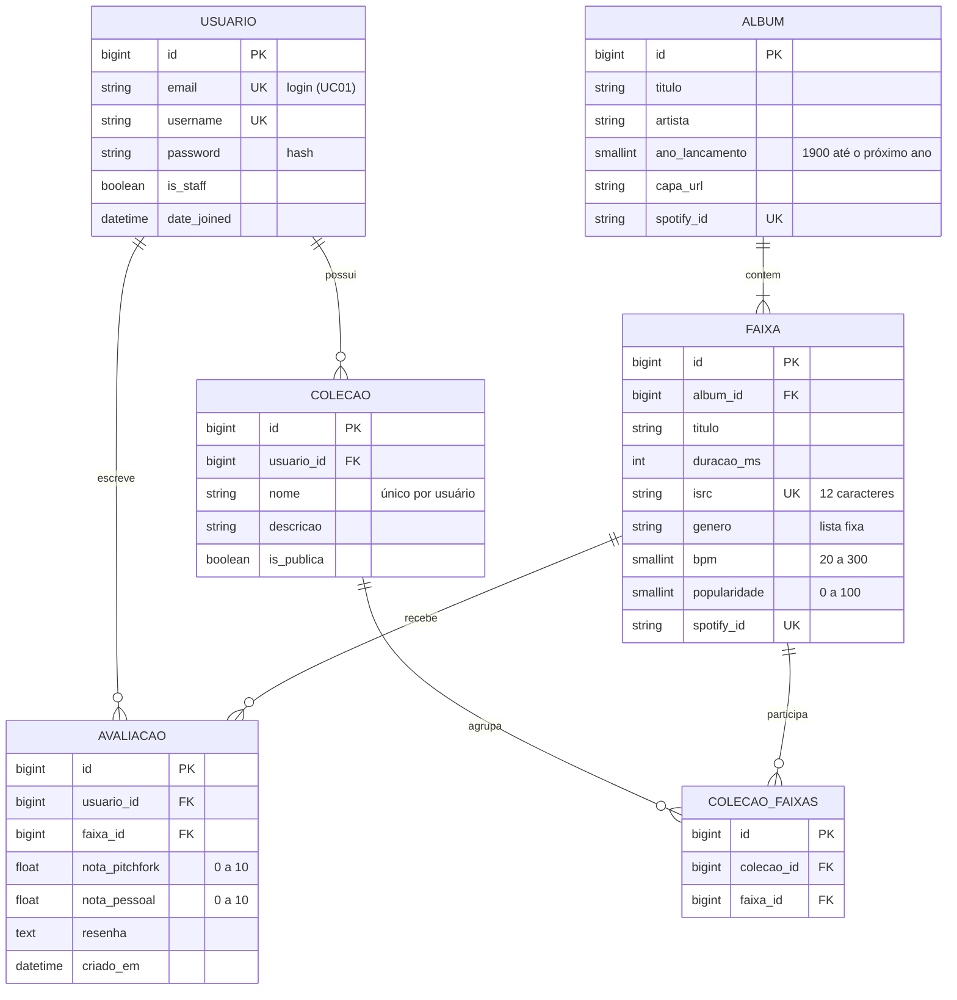

# Mudanças em relação à documentação da Fase 1

A especificação do trabalho (seção 7) permite alterações de escopo ou arquitetura na Fase 2, desde que justificadas e registradas no repositório. Este documento registra cada diferença entre o que foi planejado na Fase 1 e o que foi implementado.

| # | Fase 1 dizia | Fase 2 implementa | Justificativa |
|---|---|---|---|
| 1 | Frontend em React (`documento_arquitetura.md`, seção 2) | Templates Django + Bootstrap 5 | O backlog (TK09) e os protótipos (Django Form) já previam templates Django. Uma única aplicação simplifica o deploy e mantém a arquitetura MTV descrita no mesmo documento. |
| 2 | BPM e danceability importados do Spotify | BPM preenchido manualmente pelo curador | O Spotify descontinuou o endpoint `audio-features` para aplicações novas em novembro de 2024. O documento de visão já previa esse risco (Risco 01). |
| 2b | Popularidade importada do Spotify (UC03, UC05) | Campo `popularidade` mantido, mas opcional; preenchido apenas quando o Spotify enviar | Em teste real (17/11/2026) a Spotify Web API não retornou `popularity` para o app em modo de desenvolvimento. A importação continua funcionando com os demais dados (título, artista, álbum, ano, capa, duração e ISRC) e o indicador de popularidade do relatório mostra "—" quando não há dados. |
| 3 | Entidade FAIXA sem `genero`, `bpm` e `popularidade` | Campos adicionados à tabela `acervo_faixa` | Esses campos já eram usados no contrato da API, nos protótipos e no UC05 (relatórios), mas faltavam no DER. |
| 4 | Relacionamento N:N FAIXA–COLECAO sem tabela associativa | Tabela `acervo_colecao_faixas` criada pelo `ManyToManyField` | Implementação padrão do Django para relacionamentos N:N. |
| 5 | Faixa sem identificador do Spotify | Campo `spotify_id` (único) em FAIXA | Evita importar a mesma faixa duas vezes. |
| 6 | Botão "Importar do Spotify" preenchendo o formulário via AJAX/Fetch (protótipo, Tela 2) | Página `/faixas/importar/` com busca e resultados renderizados pelo servidor; ao escolher, o formulário de nova faixa abre preenchido | Mantém todo o consumo da API externa no backend (credenciais nunca chegam ao navegador), funciona sem JavaScript e permite exibir a capa e o álbum para o curador escolher o resultado certo. |
| 7 | Rota `/api/v1/tracks/` no UC06 e `/api/v1/faixas/` no contrato da API | `/api/v1/faixas/` | Padronização com o contrato da API. |

## Modelo de dados implementado

### Restrições implementadas
- Um usuário só pode avaliar cada faixa uma vez (`UNIQUE(usuario_id, faixa_id)`); depois disso, edita a avaliação existente.
- `nota_pessoal` entre 0 e 10, garantido também no banco (`CHECK`).
- Um usuário não pode ter duas coleções com o mesmo nome.
- Excluir um álbum exclui suas faixas; excluir uma faixa exclui suas avaliações (`ON DELETE CASCADE`).
